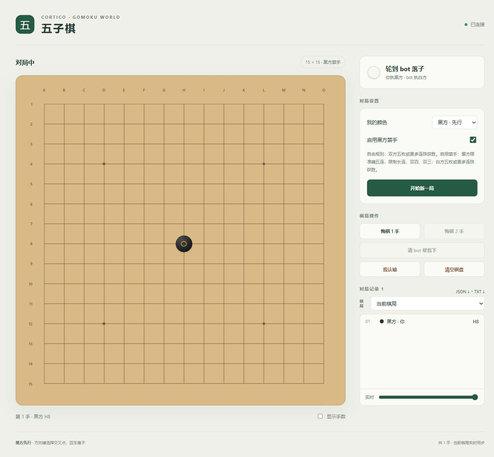

<!-- Owner: src/definition.ts, src/world.ts, src/game.ts, src/rules.ts, src/server.ts -->

# cortico-world-gomoku

[Cortico](https://github.com/Pal-AI-Lab/Cortico) 的五子棋扩展：在独立网页中与 bot 对弈，让 bot 通过事件观察棋局、通过工具选择落点。

**版本：0.1.6 · 作者：brong · 协议：MIT**



## 功能

- **网页对弈**：15×15 棋盘，选择黑白，实时同步，支持手机和键盘操作。
- **可选禁手**：黑方长连、双四、真双三检测，自动判定胜负和平局。
- **棋局操作**：开局、落子、悔棋一手或两手、认输、清空，以及请求 bot 代下一手。
- **记录与复盘**：重启恢复当前对局，保留历史，滑动查看每一手，导出 JSON 或 TXT。
- **独立网页端口**：在 Cortico 的 World 配置中修改监听地址、端口和历史保留数量。

落点由 Cortico 中配置的模型选择。扩展负责棋盘、规则校验与执行，不包含独立棋力引擎。

## 环境要求

- Node.js 22 或更高版本。
- Corepack 与 pnpm（项目固定 pnpm 11.5.0）。
- 支持 **World API v5** 的 Cortico；开发依赖为 `cortico ^0.1.12`。
- Cortico 实例已配置可用模型端点，才能让 bot 自动对弈。

## 安装

下载或克隆本仓库，然后在项目目录安装依赖：

```bash
cd cortico-world-gomoku
corepack pnpm install
```

1. 打开 Cortico 控制台的「扩展 → World → 手动安装」，选择本项目目录的**绝对路径**。
2. 重启 Cortico 进程，在 World 总览中启用「五子棋」。
3. 在五子棋 World 页点击「打开五子棋棋盘」，默认地址为 `http://127.0.0.1:7790/`。
4. 选择「我的颜色」和禁手设置，点击「开始游戏」。黑方先行，bot 执另一方。

你落子后，棋局事件会通知 bot；轮到 bot 时，它通过工具落子，网页会自动更新。也可以在 Cortico 对话中说「和我下一局五子棋，你执黑」。

本项目可从本机目录直接装载，不需要构建网页 bundle。

## 配置

| 配置 | 默认值 | 生效时机 |
|---|---|---|
| `worlds.gomoku.port` | `7790` | 重启 World |
| `worlds.gomoku.host` | `127.0.0.1` | 重启 World |
| `worlds.gomoku.botColor` | `white` | 下次新对局默认值 |
| `worlds.gomoku.forbiddenEnabled` | `true` | 下次新对局默认值 |
| `worlds.gomoku.maxHistoryGames` | `100` | 下次开局或清空时裁剪历史 |

`127.0.0.1` 只供本机访问。局域网使用可把 host 改为 `0.0.0.0`，在其他设备打开此电脑的局域网 IP 和配置端口。独立棋盘没有登录功能，能够访问网页的用户共用人类方和棋盘操作。端口占用会报告错误，不自动换端口。

## 对弈规则

列 A–O 从左到右，行 1–15 从上到下，A1 在左上。黑先行。网页选择「我的颜色」后，bot 执另一方。

- 自由规则：双方连续五枚或更多获胜。
- 禁手开启：黑方准确五连获胜，长连、双四、真正的双三禁手；白方五枚或更多获胜。准确五连优先于其他方向同时出现的禁手图形。没有交换开局协议。
- 禁手落子被拒绝，棋盘保持原样。伪活三不算双三；直活四的两个端点算同一个四。
- 悔棋可撤销最后一手或两手，恢复相应回合，也可重新打开已结束的棋局。
- 「请 bot 帮我下」发送请求，bot 可用专门的代落子工具替人类下当前一手；程序不自动选择落点。
- 棋色与规则只能在第一手之前改；开始新局或清空会先存档当前棋局。

网页实时接收 SSE 状态，断线时退回轮询。浏览历史或移动复盘滑条时只能查看；切回当前局并把滑条移到末尾才可落子。显示手数、最后一手和获胜连线均可在棋盘中查看。

## bot 工具

| 工具 | 行为 |
|---|---|
| `gomoku_get_state` | 读取完整棋盘、回合、规则、棋谱和 revision |
| `gomoku_get_history` | 列出历史，或按 gameId 读取完整记录（current 为当前局） |
| `gomoku_start` | 新局，指定 botColor 和 forbiddenEnabled |
| `gomoku_choose_color` | 第一手之前选择 bot 黑白 |
| `gomoku_set_rules` | 第一手之前切换禁手 |
| `gomoku_move` | bot 在自己回合按 column A–O、row 1–15 落子 |
| `gomoku_assist` | bot 明确为人类在其回合落子 |
| `gomoku_undo` | 撤销 count 1 或 2 手 |
| `gomoku_resign` | bot 自己认输 |
| `gomoku_clear` | 存档当前局并清空棋盘 |

修改工具必须携带最近一次读到的 revision，过期时拒绝操作并回报最新棋盘。每次修改返回完整新状态；工具设 barrierAfter，让 bot 在下一步操作前读取该回执。网页变化会投递外部事件并唤醒 bot，bot 自己的操作事件仅归档。

事件类型为 `gomoku.online/offline/started/changed/move/help/undo/resigned/cleared/ended`。所有事件描述已发生事实；读取棋盘不产生重复通知。

## 存档

文件在部署的 `dataDir/gomoku/state.json`；当前棋局、有效落子和操作记录、最近历史一并保存。World 重启恢复相同状态。包目录不保存棋局，也不访问 Persona 的 Memory。

开新局或清空保存上一局；超过保留数删除最旧历史。JSON/TXT 可导出当前局或选中的历史局。悔棋移除的手保留在操作审计文本中。

## 验证与开发

```powershell
corepack pnpm install
corepack pnpm typecheck
corepack pnpm test
```

在 Cortico 根目录：

```powershell
corepack pnpm check:extension /absolute/path/to/cortico-world-gomoku
```

自动测试覆盖规则棋形、真实回合和满盘平局、版本冲突、存档恢复、失败回滚、本地 HTTP/SSE、端口冲突、跨站请求、模型坐标与代落子。官方 check:extension 不启动 World 或模型。

实例验收：扩展卡片显示已加载；World 总览有五子棋；开启后链接打开棋盘；网页开始一局并落子，时间线出现 gomoku.started 与 gomoku.move；bot 调工具后网页实时出现另一方棋子。

## 从旧版升级

0.1.6 使用 World API v5，请先确认 Cortico 版本兼容，再更新本扩展并重启进程。旧版仅保存在内存中的棋局不能迁移；升级前请完成当前对局。

棋盘固定为 15×15、五子获胜，坐标固定为 A1–O15。旧配置 `boardSize`、`winLength`、`coordStyle`、`autoOpen` 不再使用。已有部署的 `host` 和 `port` 配置继续有效；全新部署的默认端口为 7790。旧工具 `gomoku_status`、`gomoku_place` 分别改为 `gomoku_get_state`、`gomoku_move`，修改操作需要最新 revision。

## 常见问题

**网页打不开**：确认 World 已启用，检查 World 页的实际链接。端口被占用时，在配置中换一个端口并重启 World。

**bot 不落子**：确认当前轮到 bot、Cortico 主循环没有暂停、模型端点可用；在时间线查看棋局事件和工具回执。模型是否调用工具、选择何种走法取决于当前 Persona 和模型。

**其他设备访问**：将监听地址设为 `0.0.0.0` 并重启，用运行 Cortico 的电脑的局域网 IP 访问。棋盘没有独立账号系统，所有访问者共用人类方。

**记录存在哪里**：在对应部署的 `dataDir/gomoku/state.json` 中；更新扩展不会主动清空记录。需要长期保存的历史请先导出。

## 项目结构

```text
src/
  definition.ts   World 注册入口
  config.ts       配置与默认值
  world.ts        bot 工具、事件和生命周期
  rules.ts        胜负与禁手规则
  game.ts         对局状态与存档
  server.ts       独立 HTTP / SSE 服务
  ENV_PROMPT.md   提供给 bot 的环境描述
public/
  index.html      棋盘网页
tests/            规则、对局及 World 集成测试
```

## 许可

本项目由 **brong** 维护，采用 [MIT License](LICENSE)。基于 Cortico 的 World 扩展模板开发。

